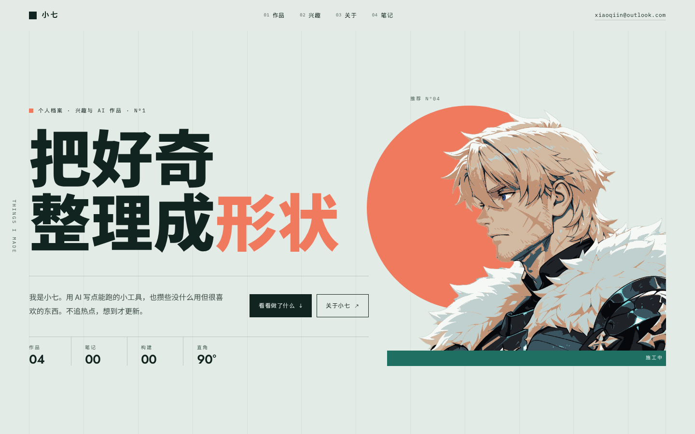

# 小七 — 个人网站 v0.3（真实内容版）

一个扁平、几何、克制的个人站。灵感来自**至上主义**（马列维奇的方与圆）和包豪斯那套网格、三色、无衬线大字的构成做派。

纯静态、零构建、零 JS 依赖：双击 `index.html` 就能看。

> **本站已剔除全部虚构内容**（依据 `_proc/20261105_real-content-audit/AUDIT.md`）：作品 4 件、兴趣 3 条、NOW 4 行、笔记 0 篇，全部能指到真实产物；没有的说法、数字、日期、截图一律不写。



---

## 1. 怎么看

直接双击 `index.html`，或者：

```bash
cd personal-site
python3 -m http.server 8080
# 打开 http://localhost:8080
```

| 页面 | 说明 |
|---|---|
| `index.html` | 主页：首屏（含推荐位）/ 作品 4 件 / 兴趣 3 条 / 关于 + NOW / 笔记（空态）/ 页脚 |
| `work/dsh-status/index.html` | 唯一的作品详情页（Nº02 状态面板）；Nº03/Nº04 与两条施工中的兴趣都指向 `wip.html` |
| `suprematism/index.html` | 马列维奇至上主义图录 32 幅（兴趣 01 的落点） |
| `guide/index.html` | 长文《两棵树，各一本账》（作品 Nº01「记账工具」的落点） |
| `wip.html` | 「施工中」页：Nº03 / Nº04 两张卡、兴趣 02 / 03 两条行、首屏推荐位都指到这里 |
| `404.html` | GitHub Pages 的 404 页（自带路径修正脚本，`noindex`） |
| `feed.xml` | RSS 2.0，**0 条 item**（笔记区是空态，`<description>还没写。</description>`） |
| `palettes.html` | 配色对照页（选色用，不属于网站本身） |
| `DESIGN-SUBPAGE.md` | **子页面设计基本规范**（新增 work 详情页前先读） |

**彩蛋**：在电脑上按住 `G`，全站会切成「网格 X 光」——参考线变珊瑚色浮到内容之上，右下角显示当前列数与视口尺寸。

截图在 `preview/`，**已于 2026-11-11 按当前站态重出**（4 件作品 / 3 条兴趣 / 笔记空态 / 推荐位）。以后改版请用 `node tools/shoot.mjs` 重出，别让截图和页面分家：

| 文件 | 内容 |
|---|---|
| `01-hero.png` | 首屏 1440×900 |
| `02-full.png` | 桌面整页 |
| `03-mobile.png` | 手机整页 390 |
| `04-work.png` | 作品区细节（2x） |
| `05-tablet.png` | 平板 820×1180（另有 `05-tablet-full.png` 整页） |
| `06-drawer.png` | 手机全屏目录 |
| `07-detail.png` | 作品详情页 1440（另有 `07-detail-full.png` 整页；对应现存唯一的 `work/dsh-status/`） |
| `08-grid.png` | 网格 X 光模式 |

---

## 2. 设计说明

### 概念

用三个词概括：**构成、秩序、留白**。

整个页面是一张会滚动的构成海报：所有内容都落在网格上，装饰只用**直线、直角和圆**——没有阴影、没有渐变、没有圆角。首屏右侧是一幅抠好的人物像，站在一条青色横条上，身后一颗珊瑚圆——像一张拼贴海报。颜色只有雾青纸、墨绿，加珊瑚和青两支强调色，每一屏只让一种颜色当主角。

### 视觉系统

| 项目 | 取值 |
| --- | --- |
| 雾青 `--paper` | `#E3EBE7` |
| 深一档雾青 `--paper-2` | `#D2DFDA` |
| 墨绿 `--ink` | `#12241F` |
| 珊瑚 `--coral` | `#F07A5E` |
| 青 `--teal` | `#1F6F63` |
| 浅雾青 `--sage` | `#AFC6BE` |
| 标题 | Jost 700/800（Futura 气质）+ Noto Sans SC 900 |
| 正文 | Noto Sans SC 400 |
| 标注 / 编号 | IBM Plex Mono，大写 + 字距 `.16em` |
| 网格 | 桌面 12 栏 / 平板 8 栏 / 手机 4 栏，页面上有极淡的竖向参考线 |
| 线宽 | 区块顶 2px「承重线」＋ 卡片内 1px「构件线」 |
| 数字 | 全站 `tabular-nums slashed-zero`，列与列对得齐 |
| 圆角 | 0 |

### 结构

```
01 作品    四件等宽 2×2，每件：封面构成 + 一句「它解决什么」+ 状态 + 年份
02 兴趣    墨绿底编号清单 3 条，悬停整行变浅雾青——最像「档案」的一屏
03 关于    左边自述 + 事实表，右边「NOW」面板：最近真在做什么、什么状态
04 笔记    现在是空态（两条直线 + 一句话），有真事再往里写
页脚       大字「说点什么？」+ 写信 / RSS / 回顶部 + 四色小色块
```

首屏右侧的人像不是装饰，是**推荐位**：整块包在 `<a class="stage-link" href="#work">` 里，角标 `推荐 Nº04` / `施工中`，点击落到作品区。

### 三端适配

| 宽度 | 做法 |
|---|---|
| `>1024px` | 12 栏；首屏文案 1-7 栏、推荐位 8-12 栏；作品四件等宽 2×2（各 6 栏） |
| `681–1024px` | 8 栏；首屏文案沉顶、构图沉底（一张竖版海报）；作品仍是 2×2（各 4 栏）；关于页单列 |
| `<=680px` | 4 栏全单列；四张作品卡全部通栏（不再交错缩进）；顶部换成全屏目录；数字表格 2×2 细线格 |
| 矮屏 (`max-height:560px`) | 收紧首屏垂直间距、缩小构图，横屏手机也能一眼看到标题与按钮 |

### 动效（都很轻）

- 滚动入场：元素上浮 14px + 淡入，按 `--d` 错开；**无 JS 时不隐藏内容**
- 首屏构图：跟随鼠标微视差，形状各自有深度
- 作品卡片：悬停时图形轻微位移/旋转，四角出现 14px 准星
- 兴趣与笔记：悬停时颜色从左边「刷」过去；触屏用按下瞬间的反白替代
- 全部动效在系统开启「减弱动态效果」时自动关闭；打印时只留内容

### 可访问性 / 工程

- 语义化标签、`skip link`、`:focus-visible` 焦点环（深底自动换浅色）
- 所有可点元素 ≥ 44×44；手机端目录支持 Esc 关闭与焦点圈定
- 配色全部过 WCAG AA（含小字：`--muted` 5.6:1、深底小字 7.2:1）
- 零构建、零 JS 依赖；只有人像一张位图，作品封面是 SVG / CSS 构成
- 已测 1920 / 1440 / 1280 / 1024 / 820 / 768 / 680 / 390 / 320 九档，无横向溢出
- 字体走 Google Fonts，断网时回退系统字体（不报错、不破版）

---

## 3. 首屏人物图

首屏右侧的人物来自 `assets/src-figure.png`。原图背景是薄荷绿，而且画师**用这个背景色画了头发和毛领的阴影**，所以不能简单抠色，否则人物内部会破洞。

处理脚本 `assets/png-tool.js`（纯 Node，只用内置 zlib，不装任何包）做三件事：

1. 从四边泛洪，标出真正的外部背景（内部同色阴影保留）
2. 把背景色族整体重映射到配色里的浅雾青 `#AFC6BE`
3. 边缘 1px 羽化，导出带 alpha 的 PNG

换配色后重跑：

```bash
cd assets
node png-tool.js src-figure.png figure.png '#AFC6BE' 74
```

最后一个参数是色差容差，越大替换得越狠。

## 4. 配色备选

`palettes.html` 里有 8 组备选配色，每组都带首页缩略与深色区示意，点色块可复制色值。当前采用 **方案 05「雾青与珊瑚」**。换配色只需改 `style.css` 顶部 `:root` 里的几个变量。

---

## 5. 怎么改成你自己的

| 想改什么 | 去哪里 |
| --- | --- |
| 名字 / 标题 / 文案 | `index.html`；结构化副本在 `content.json`，有人看的版本在 `COPY.md` |
| 作者信息 / 邮箱 | `index.html` 顶栏、关于页 facts、页脚 |
| 配色、字体、间距 | `style.css` 顶部的 `:root` |
| 加一个作品 | `index.html` 复制一个 `<article class="work">`（四件等宽，桌面 2×2）+ 在 `work/` 里加一页 |
| 加一条兴趣 | 复制一个 `<li>`：可点行用 `a.index-row--go`（4 个子元素），待建行用 `.index-row--wip`（3 个子元素 + `.wip` 角标） |
| 加一篇笔记 | 笔记区现在是 `.notes-empty` 空态；有第一篇时换成 `<div class="notes">` + `<details class="note">`，正文写在 `<div class="note__body">`，并同步 `feed.xml` 与 `hero.stats` 的「笔记 00」 |
| 换成真实作品图 | 把 `<div class="thumb">` 换成 ``，几何封面可以保留做默认 |
| 笔记 RSS | 改完笔记后同步 `feed.xml`（现在是手写静态文件） |

> **数字口径**：全站只保留能当场指到东西的数字（作品 04 / 笔记 00 / 构建 00 / 直角 90° / 图录 32 幅 / NOW 里的任务号）。旧版按语境编的硬数字已全部删除，别再写回来——`COPY.md` §9 有完整清单。

---

## 6. 挂到 GitHub Pages

```bash
cd personal-site
git init
git add .
git commit -m "initial: personal site"
git branch -M main
git remote add origin git@github.com:<你的用户名>/<仓库名>.git
git push -u origin main
```

然后在 GitHub 仓库 → **Settings → Pages** → Source 选 `Deploy from a branch` → 分支 `main` / 目录 `/ (root)` → Save。

> 用户已确认**只建私有仓库、不发布 Pages**（Pages 会公开站点）。若以后要「有链接才可看」，建议 Cloudflare Pages 连私有仓库 + Access 邮箱白名单。

---

## 7. 还能往哪儿走

1. **中英切换**：版式已预留双语位（中文主标题 + 英文小标注），接一个 `data-lang` 切换即可。
2. **真实作品图**：几何封面很好看，但作品还是要露脸——建议「几何封面 → 悬停/点击换成截图」。
3. **内容用 Markdown 管**：作品一多就手写 HTML 容易乱，可以用 Eleventy / Astro 生成，输出仍是纯静态。
4. **更多彩蛋**：网格 X 光已经做了；可以再加「按 R 反色」之类的键位。

---

## 文件

```
personal-site/
├── index.html      # 全部内容
├── style.css       # 全部样式（含设计变量）
├── main.js         # 滚动进度 / 入场 / 视差 / 移动目录 / 网格 X 光，约 7KB
├── content.json    # 文案结构化副本（works 4 / interests 3 / now.rows 4 / notes []）
├── COPY.md         # 文案包与数字核对清单
├── feed.xml        # RSS（0 条 item）
├── work/           # 唯一的作品详情页 dsh-status/ + 共享 work.css
├── suprematism/    # 至上主义图录 32 幅（兴趣 01 的落点）
├── guide/          # 长文《两棵树，各一本账》（作品 Nº01 的落点）
├── tools/shoot.mjs # 截图与度量脚本（可选，验证用）
├── assets/         # 人物图、原图、抠图脚本、作品封面
├── palettes.html   # 配色对照
├── preview/        # 渲染截图（2026-11-11 按当前站态重出）
├── README.md       # 本文件
└── HANDOFF.md      # 给下一个 agent 的交接文档
```
